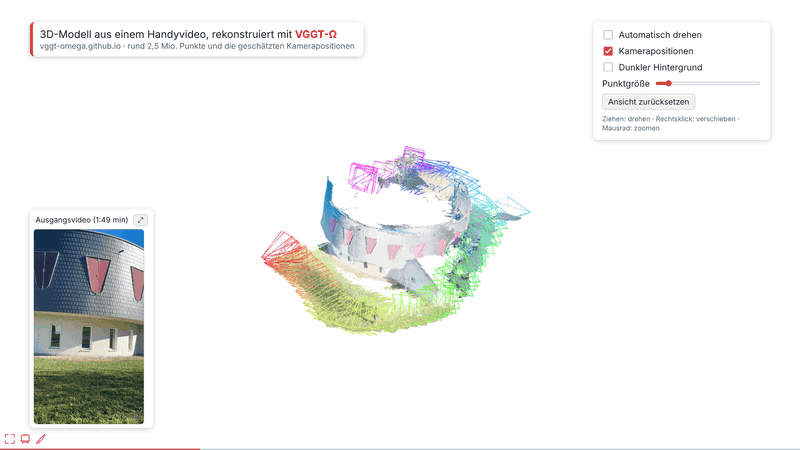

# quarto-dhbw-slides-theme

Quarto-Theme für Vorlesungsfolien im DHBW-Look, dazu Übungsblätter und
Klausuren im selben Stil.

[](https://dermahax.github.io/quarto-dhbw-slides-theme/)

**[▶ Beispielfolie live ausprobieren](https://dermahax.github.io/quarto-dhbw-slides-theme/)**: Modell drehen, zoomen, Video abspielen.

## Features

- **DHBW-Design** mit Logo, rotem Titelband und Blöcken im Beamer-Stil
  (Definition, Beispiel, Aufgabe, Hinweis)
- **Kastenlose Formen** für Leitfragen, Merksätze, Steckbriefe und Spalten
- **Tabellen** mit Kopfband und Streifen ohne eigene Formatierung
- **Pop-ups** und schrittweise Aufbauten als Fragmente
- **Offline**: eine einzelne HTML-Datei, Formeln mit lokal eingebundenem KaTeX
- **Speaker-Ansicht** mit Layout „Folie + Notizen“, Formeln und Tabellen in den
  Notizen, Animationen als Overlay
- **Zeichnen** auf Folie und Tafel, synchron zwischen Speaker-Ansicht und Beamer
- **PDF-Export** beim Rendern, aufbauende Folien als eine Seite im Endzustand
- **Organisatorisches-Folie** per Shortcode ``
- **Übungsblätter** als PDF oder Jupyter-Notebook, mit automatischer Lösungsfassung
- **Klausur-Modus** nach der DHBW-Klausurvorlage mit Deckblatt und Punktesumme

## Kurzanleitung

```
quarto add dermahax/quarto-dhbw-slides-theme
```

In `_quarto.yml`:

```yaml
format:
  dhbw-slides-revealjs: default
```

Dann `quarto render`. Alle Optionen stehen im
[Handbuch](_extensions/dhbw-slides/README.md), zum Ausprobieren gibt es
`example.qmd`.

Versionshistorie: [CHANGELOG.md](CHANGELOG.md)
