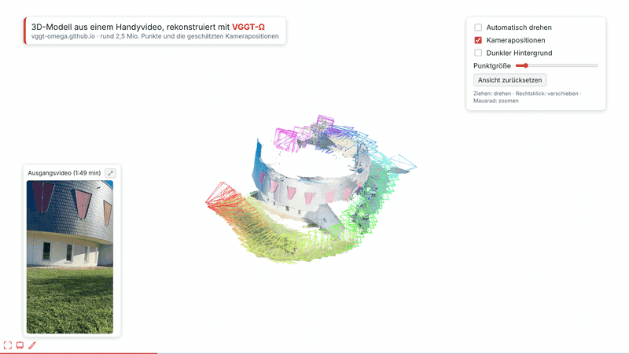

# quarto-dhbw-slides-theme

Quarto-Theme für Vorlesungsfolien im DHBW-Look, dazu Übungsblätter und
Klausuren im selben Stil.

[](https://dermahax.github.io/quarto-dhbw-slides-theme/)

**[▶ Beispielfolie live ausprobieren](https://dermahax.github.io/quarto-dhbw-slides-theme/)**: Modell interaktiv betrachten, Zeichentools (unten rechts) nutzen

## Features

- AI- und Menschenlesbare Slides in markdown Form
- Ermöglicht effizienten KI-Zugriff, z.B. durch [AI-Tutor](https://dhbw-folien-tutor.maplelodge16.chatgpt.site/)
- Rendern als html, pdf oder jupyternotebook möglich
- Zeichnen auf Folie und Tafel, synchron zwischen Speaker-Ansicht und Beamer, gut für Live- und Onlinevorlesungen
- Übungsblätter als PDF oder Jupyter-Notebook, mit automatischer Lösungsfassung
- Klausur-Modus nach der DHBW-Klausurvorlage mit Deckblatt und Punktesumme

## Kurzanleitung

```
quarto add dermahax/quarto-dhbw-slides-theme
```

In `_quarto.yml`:

```yaml
format:
  dhbw-slides-revealjs: default
```

Dann `quarto render`. Alle Optionen stehen im
[Handbuch](_extensions/dhbw-slides/README.md), zum Ausprobieren gibt es
`example.qmd`.

Versionshistorie: [CHANGELOG.md](CHANGELOG.md)
